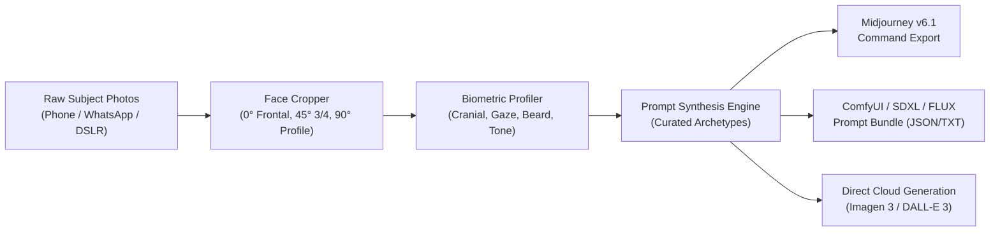

# 📸 StudioPortraits - AI Studio Headshots & Portrait Generator

[](https://www.python.org/)
[](https://opensource.org/licenses/MIT)
[](CONTRIBUTING.md)
[](SECURITY.md)

An open-source AI studio portrait generator that transforms everyday photos into professional studio headshots, executive portraits, and stylized avatars.

Whether you are crafting **executive LinkedIn business headshots**, **gritty chiaroscuro cinematic characters**, **3D minimalist vinyl designer toys**, **timeless monochrome studio fine art**, or **official biometric passport photos**, this toolkit gives you consistent facial likeness and reproducible aesthetics.

---

## 🌟 Key Features

- 📐 **Calibrated Multi-Angle Cropping**: Standardized aspect ratio normalization (`1:1 Square`, `4:5 Editorial`, `9:16 Story`, `3:2 Film`, and `ICAO/US/EU Passport` formats) with automatic EXIF orientation and golden-ratio portrait headroom.
- 🧬 **Biometric Facial Profiler**: Structured extraction of craniofacial geometry, mandibular contour, eye geometry, beard grooming, and **Fitzpatrick skin type** scale, exporting directly to markdown reports (`facial_profile.md`).
- ✨ **Curated Style Presets**: Battle-tested prompt recipes engineered with physical camera optics (Leica M Monochrom, Cooke Anamorphic, ARRI Alexa LF), authentic lighting setups (Rembrandt, chiaroscuro, beauty dish), and negative prompt suppressors.
- 🚀 **Multi-Platform Output Engine**:
  - **Midjourney v6.1**: One-click ready `/imagine prompt: ... --ar 4:5 --v 6.1 --style raw` commands.
  - **ComfyUI / Stable Diffusion / FLUX**: Formatted prompt dictionaries and sampling parameters.
  - **Direct Cloud APIs**: Native support for Google GenAI (Imagen 3) and OpenAI (DALL-E 3).
- 💻 **Dual Interface**:
  - **Rich CLI**: Blazing fast command-line tool for developers and batch automation.
  - **Streamlit Web Studio**: Beautiful browser-based GUI for visual cropping, live profiling, and prompt export.
- 🔒 **Privacy by Design**: Subject reference photos and personal identity archives remain **100% local**. Our strict `.gitignore` architecture guarantees zero personal images are ever tracked or leaked to Git.

---

## 🔄 Pipeline Architecture



---

## 🚀 Quickstart

### 1. Installation

```bash
# Clone the repository
git clone https://github.com/MirhazarKhan/studioportraits.git
cd studioportraits

# Create and activate virtual environment
python -m venv .venv

# Windows:
.venv\Scripts\activate

# Linux / macOS:
source .venv/bin/activate

# Install dependencies
pip install -r requirements.txt
```

### 2. Verify Environment

```bash
python main.py check-env
```

### 3. Interactive Web Studio

Launch the interactive visual studio in your browser:
```bash
streamlit run app.py
```

---

## 🖥️ Command-Line Interface (CLI)

### List Available Style Presets
```bash
python main.py list-styles
```

### Calibrate & Crop Reference Photos
```bash
# Crop a single photo to 1:1 square
python main.py crop --input inputs/sample_subject/photo.jpg --aspect-ratio 1:1

# Batch crop an entire subject folder to 4:5 editorial portrait
python main.py crop --input inputs/sample_subject/ --aspect-ratio 4:5 --output outputs/subject/crops/
```

### Build a Biometric Profile
```bash
python main.py profile --name "Subject Name" --crops-dir outputs/subject/crops/ --output outputs/subject/facial_profile.md
```

### Compile Generation Prompts
```bash
# Compile prompt using a saved profile
python main.py prompt --style tlou2 --profile outputs/subject/facial_profile.md

# Compile prompt on the fly
python main.py prompt --style vinyl_toy_tan --subject "Alex Rivera"
```

### Synthesize or Export Prompt Bundles
```bash
# Export prompt bundle (JSON + TXT + Midjourney) to outputs/
python main.py generate --style tlou2 --profile outputs/subject/facial_profile.md --provider export

# Synthesize directly via Google Imagen 3 (requires GEMINI_API_KEY in .env)
python main.py generate --style studio_monochrome --profile outputs/subject/facial_profile.md --provider gemini
```

---

## 🎨 Curated Style Archetypes

| Style ID | Archetype | Target Ratio | Core Aesthetic |
|---|---|---|---|
| `tlou2` | **The Last of Us Part II Survivalist** | `4:5` | Gritty chiaroscuro cinematic lighting, weathered tactical jacket, volumetric dust beams, Cooke Anamorphic 85mm. |
| `vinyl_toy_tan` | **3D Minimalist Vinyl Toy (Designer Tan)** | `1:1` | Cute designer collectible figurine, smooth matte tan clay finish, soft lightbox illumination, Octane render. |
| `vinyl_toy_porcelain` | **3D Minimalist Vinyl Toy (Porcelain)** | `1:1` | Scandinavian minimalism, smooth matte porcelain and frosted resin finish, neutral off-white studio. |
| `studio_monochrome` | **Cinematic Low-Key Studio** | `4:5` | Timeless black-and-white fine art, dramatic Rembrandt split lighting, silver gelatin tonal range, Leica M Monochrom. |
| `editorial_monochrome_knit` | **Fine-Art Monochrome Studio (Waffle Knit)** | `4:5` | Folded-arms editorial portrait, textured waffle-knit crewneck sweater, soft sculptural lighting, Leica M Monochrom. |
| `street_monochrome_sunglasses` | **Street Editorial (Sunglasses & Harrington)** | `4:5` | High-contrast black-and-white outdoor candid, clasped hands pose, dark sunglasses, Harrington jacket, concrete wall. |
| `dualtone_crimson_cyan` | **Cinematic Dual-Tone Studio (Crimson & Cyan)** | `4:5` | Inky black studio void, split crimson-red and cyan-blue rim lights, high popped-collar coat, silver chain. |
| `editorial_forbes` | **Bespoke Executive Editorial** | `4:5` | Midnight-navy Italian wool tailoring, high-rise architectural backdrop, twilight cityscape bokeh, Hasselblad 100mm. |
| `cinestill_vintage` | **Vintage 35mm Cinestill 800T** | `3:2` | Candid 1980s night street aesthetic, red tungsten halation blooms, authentic analog film grain. |
| `cyberpunk_neon` | **Neo-Noir Cyberpunk** | `16:9` | High-contrast cyan and neon magenta ambient lights, rain-slicked skin, Tokyo night alleyway bokeh. |
| `passport_biometric` | **Official Biometric Studio** | `1:1` | Clean even dual-softbox lighting, neutral off-white background, ICAO biometric compliance. |

---

## 📁 Repository Structure

```
portrait-generator/
├── .github/
│   ├── workflows/ci.yml           # Multi-OS CI testing matrix
│   └── ISSUE_TEMPLATE/            # Bug report & feature templates
├── inputs/
│   ├── .gitkeep                   # Tracks directory while ignoring local photos
│   └── sample_subject/README.md   # Guidelines for reference photo kit
├── outputs/
│   └── .gitkeep                   # Local generated crops and prompt bundles
├── portrait_generator/            # Core Python package
│   ├── __init__.py                # Version & exports
│   ├── config.py                  # Pydantic environment configuration
│   ├── cropper.py                 # Face detection & aspect ratio cropper
│   ├── profiler.py                # Biometric modeling & markdown generator
│   ├── prompt_engine.py           # Style presets & prompt compiler
│   └── generator.py               # Generation coordinator & export bundles
├── templates/
│   ├── biometric_profile_template.md # Standardized biometric extraction schema
│   └── style_presets.json         # Curated style prompt templates
├── tests/                         # Native unit tests
│   ├── test_cropper.py            # Cropping & aspect ratio tests
│   ├── test_profiler.py           # Biometric profile serialization tests
│   └── test_prompt_engine.py      # Prompt compilation tests
├── .env.example                   # Environment variable template
├── .gitignore                     # Strict privacy filter for personal photos
├── app.py                         # Interactive Streamlit Web Studio
├── CHANGELOG.md                   # Version history
├── CONTRIBUTING.md                # Contribution guidelines
├── LICENSE                        # MIT License
├── main.py                        # Rich CLI entrypoint
├── pyproject.toml                 # Modern package metadata
├── requirements.txt               # Production dependencies
├── requirements-dev.txt           # Testing & linting dependencies
└── SECURITY.md                    # Privacy & responsible AI policy
```

---

## 🔒 Privacy & Ethical AI

Portrait Generator is committed to **subject privacy**:
1. **Local-First**: All personal photos, crops, and subject profiles remain on your machine.
2. **Git Protected**: The included `.gitignore` rules prevent any accidental commits of photos (`*.heic`, `*.tif`, `*.jpg`, `*.png`), subject archives, or secret keys.
3. **Subject Consent**: Always obtain explicit permission before profiling and generating portraits of real individuals.

---

## 🧪 Testing

Run the test suite using Python's native test runner:
```bash
python -m unittest discover tests/
```

---

## 📄 License

Distributed under the **MIT License**. See [`LICENSE`](LICENSE) for details.
